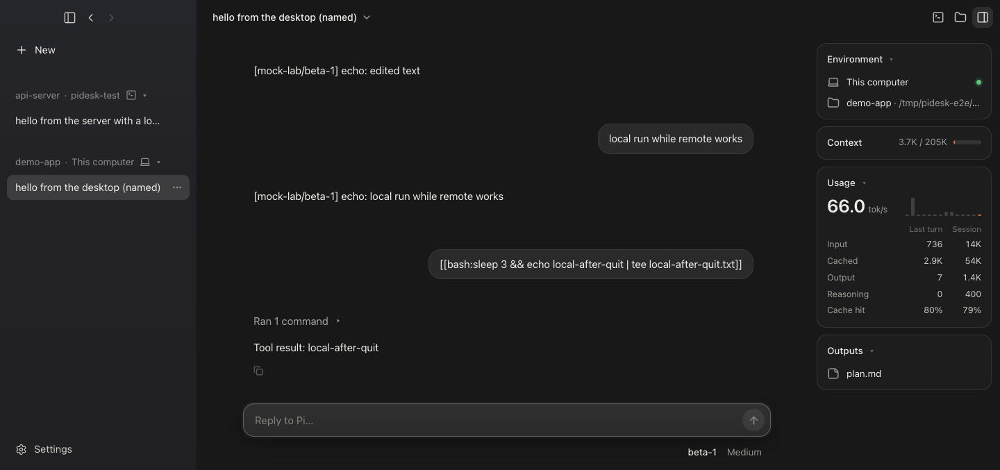

# Pi Desktop

[](https://github.com/Ljh0107-L/PI-Desktop/actions/workflows/ci.yml)

A Claude Desktop–style app for the [Pi](https://github.com/earendil-works/pi) agent harness: run sessions on this computer and on any SSH host side by side, and pick any model from any provider for each session.



## Install

Download the `.dmg` for your Mac (Apple Silicon `arm64` or Intel `x64`) from [Releases](https://github.com/Ljh0107-L/PI-Desktop/releases/latest) and drag Pi Desktop to Applications. The app is ad-hoc signed rather than notarized, so the first time **right-click it → Open** (or run `xattr -dr com.apple.quarantine "/Applications/Pi Desktop.app"`). After that it updates itself: when a new release is downloaded, an **Update** button appears next to Settings.

## Updates behind a shared company proxy

Since **0.1.18**, update checks read the public [`latest-mac.yml` Release asset](https://github.com/Ljh0107-L/PI-Desktop/releases/latest/download/latest-mac.yml), not `api.github.com`. They need no GitHub token and do not consume the unauthenticated REST API's shared-IP 60-requests/hour allowance. Downloads are pinned to the manifest's version and verified against its SHA-512 and size.

If **0.1.17 or earlier** shows `GitHub returned 403`, download the latest DMG from [Releases](https://github.com/Ljh0107-L/PI-Desktop/releases/latest), quit the desktop and replace the app in Applications once. Your settings and conversations are stored separately. Future updates use the new method. The network must still allow `github.com` and GitHub's release-asset download host; this does not bypass a company firewall or general download restrictions.

## Run from source

```sh
npm install --ignore-scripts && node node_modules/electron/install.js
npm start                      # builds the renderer and opens the app
npm run dist                   # builds the .dmg / .zip into release/
```

Add a provider under **Settings (bottom left) → Models** (built-in providers such as DeepSeek, Anthropic, OpenAI, OpenRouter, or any OpenAI/Anthropic-compatible endpoint), choose an environment and folder under the message box, and start typing.

## How it works

- **Sessions are Pi processes.** Each session runs `pi --mode rpc` locally, or on an SSH host through system OpenSSH ([`core/transports.mjs`](core/transports.mjs), [`core/pi-session.mjs`](core/pi-session.mjs)). Many sessions on many machines run at once. The bridge extension is staged outside the app's ES-module package, so Pi binds it to its own bundled modules and starts in a fraction of a second ([`app/main/extensions.mjs`](app/main/extensions.mjs)).
- **SSH hosts come from `~/.ssh/config`.** On first use the app installs Pi (same version as the desktop) and the bridge extension under `~/.pidesk` on the host ([`app/main/remote-setup.mjs`](app/main/remote-setup.mjs)).
- **Keys stay on this Mac.** API keys are encrypted with Electron `safeStorage` (Keychain). When a session starts, the key travels as the first stdin line of the SSH channel — never in argv on either machine — and the bridge extension ([`agent/pidesk-bridge.js`](agent/pidesk-bridge.js)) removes it from the environment before any tool runs.
- **Model egress through the Mac.** If a host cannot reach a provider (e.g. a corporate endpoint), its model traffic is tunnelled back through this Mac with an allowlisted CONNECT proxy and `ssh -R`; TLS stays end-to-end ([`core/egress-proxy.mjs`](core/egress-proxy.mjs)).
- **Sessions on SSH hosts survive disconnects and quitting.** On each host a small relay daemon ([`agent/pidesk-relay.mjs`](agent/pidesk-relay.mjs)) owns the Pi processes; the desktop attaches to it over SSH. When Wi-Fi drops, the laptop sleeps or the app quits, Pi keeps working there; the desktop reconnects with backoff, replays the events it missed and gets back any question still waiting. On launch it re-attaches to sessions still running. **On this Mac nothing keeps running after the app quits:** local Pis stop with it and resume from their session files when opened again, and the app's shared SSH connections close. Archiving or deleting a session stops its process.
- **No folder conversations stay together.** The sidebar has one No folder group per machine, while each conversation keeps its own projectless working directory and history. Ordinary projects are grouped by directory.
- **Agents.** The model can start agents that work in their own context and report back, so long searches and side tasks don't fill the conversation: `explore` (read-only), `general` (coding tools), `fork` (a copy with the whole conversation, sharing its prompt cache) and custom agents from `.pi/agents` or `.claude/agents`. They run in the background: each report arrives as a message and starts the model's next turn. Agents can be continued with a follow-up, stopped, or given their own git worktree. Click one to watch its activity, stop it or message it. Pi delegates sparingly (the main work stays with it) and starts at most 2 new agents per message, adjustable in Settings → Agents. See [Agents](docs/subagents.md).
- **Ultra.** Turn on Ultra under the message box and hand Pi a request: it works on it on its own until it is done, for hours if it takes that, with your full trust. It never stops to ask (a question gets "nobody is here: decide and note the assumption"), starts its next turn itself while the request is unfinished, waits out provider errors (30 s, growing to 10 min, for as long as it takes) and keeps a progress log that survives context compaction. To finish, it audits its work against the request and then passes an independent review by a fresh agent that can run checks but not edit; gaps send it back to work. A message you send meanwhile joins the task. A banner shows what it is working on and for how long, with Stop and Resume, and a notification says when it is done. On this Mac the Mac stays awake while it works; on an SSH host it carries on when the Mac sleeps or the app quits ([`agent/pidesk-ultra.mjs`](agent/pidesk-ultra.mjs)).
- **Goals.** `/goal <objective>` (modelled on Codex) keeps Pi working across turns: when a run ends while the goal is active, the bridge starts a continuation turn, until the model marks the goal complete (or blocked) with `update_goal`, or you pause or clear it. It runs inside Pi, so on an SSH host it continues while the desktop is closed.
- **Composer.** Paste or drop images and files (or use the paperclip); type `/` for commands (`/goal`, `/compact`, `/fork`, `/new`, plus Pi's skills and prompt templates). Hover a message you sent to edit it and regenerate from there.
- **Speed.** For models whose provider sells faster processing, the ⚡ control under the message box picks **Fast** (OpenAI's Fast mode on GPT-5.6 and GPT-6 models; Anthropic's fast mode on Claude Opus 5.5, and on Opus 5 and 4.8 in preview; 2× the price) or **Ultrafast** (OpenAI, GPT-6 Astra and GPT-6.1 Sol; 6× the price). It applies to the conversation and its agents from the next request. Usage shows the speed each reply ran at as the provider reports it, and its cost at that speed. A rate limit or overload at the faster speed drops one step for five minutes instead of failing the run ([`agent/pidesk-speed.mjs`](agent/pidesk-speed.mjs)).
- **Generation TPS.** Usage shows the decode speed: output tokens after the first chunk ÷ first→last output time observed where Pi runs, excluding TTFT, tool execution and completion trailers (approximate, `~`). With hidden or summarized reasoning (OpenAI, Anthropic) it is timed on the answer and tool output, **Answer generation**: the reasoning is generated at the same speed, but its own timing isn't visible, and the wait before the answer also holds reading the prompt and summarizing the reasoning (in real streams, about half the answer's rate at standard speed). Each reply shows its own speed when it can be timed, short ones from fast models included; a few-token reply keeps the model's last measured speed. When no window can be measured (a relay that buffers and replays the reply in one burst, a single chunk, older timing), it shows **Generation (estimated)**: from the provider's own start marker when the reasoning was hidden (errs low), else the observed output window when long enough, else output ÷ the whole response time (which includes TTFT, so it errs low); token counts come from the provider, or from the visible output when it reports none.
- **Math.** Replies and Markdown previews render LaTeX with KaTeX: `$…$` and `\(…\)` inline, `$$…$$` and `\[…\]` as display math, while prices such as `$5` stay text ([`app/renderer/src/markdown-math.js`](app/renderer/src/markdown-math.js)).
- **Downloads.** Download a file from the file pane (or the tree's right-click menu) to this Mac, also from an SSH host ([`app/main/file-download.mjs`](app/main/file-download.mjs)). The model hands over finished files with a `present_files` tool, shown as cards with Open and Download.
- **Panels.** File preview with a tree and Markdown/source views, a per-turn change review with diffs, and a terminal in the session's folder on the session's machine (⌃\`).
- **YOLO, with questions.** There is one mode: Pi runs commands and edits files without approval prompts. The bridge adds an `ask_user` tool so the model can still ask you something — the desktop shows a question card with choices or a free-text answer, and anything you type in the message box while a question is open answers it. Questions survive reconnects like everything else.

## Layout

```
agent/         runs on each host: Pi bridge extension, session relay daemon
app/main/      Electron main process: sessions, SSH setup, settings, keys
app/renderer/  React UI
core/          Pi RPC client, local/SSH transports, egress proxy
test/          protocol, relay and end-to-end suites, mock model, throwaway sshd
build/         app icon, packaging hook
```

## Tests

CI runs every suite on GitHub's macOS runners on each push; screenshots are uploaded as an artifact. Locally:

```sh
npm run test:backend       # lifecycle, stream recovery, and API-free updater regressions
npm run test:sshd &        # throwaway unprivileged sshd on 127.0.0.1 (host alias pidesk-test)
npm run test:protocol      # Pi RPC protocol, local and over SSH
npm run test:relay         # sessions survive drops, replay, pending questions, secrets
npm run test:e2e           # drives the real UI with Playwright; screenshots in /tmp/pidesk-e2e/shots
```

The end-to-end suite uses `/tmp/pidesk-e2e/remote-install` on its throwaway SSH host rather than installing into your `~/.pidesk`. Its relay cleanup is scoped to that test installation. Release tags run both CI jobs before packaging and publishing.

The app icon (π on Claude's coral) is generated by [`build/make-icon.py`](build/make-icon.py).

## Known limits

- With model egress through the Mac, a remote session can only call its model while the Mac is connected; it resumes when the desktop reconnects.
- The app is not notarized (no Apple Developer ID), which is why updates are installed by the app itself rather than Squirrel.
