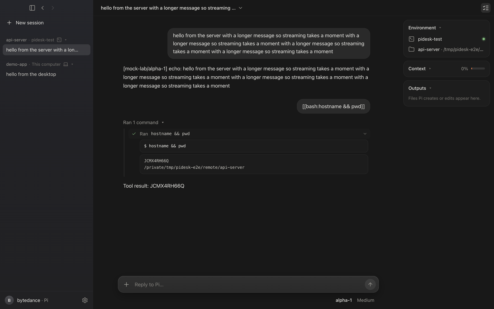

# Pi Desktop

[](https://github.com/Ljh0107-L/PI-Desktop/actions/workflows/ci.yml)

A Claude Desktop–style app for the [Pi](https://github.com/earendil-works/pi) agent harness: run sessions on this computer and on any SSH host side by side, and pick any model from any provider for each session.



## Run

```sh
npm install --ignore-scripts && node node_modules/electron/install.js
npm start                      # builds the renderer and opens the app
```

Add a provider under **Settings (gear, bottom left) → Models & keys** (built-in providers such as DeepSeek, Anthropic, OpenAI, OpenRouter, or any OpenAI/Anthropic-compatible endpoint), choose an environment and folder under the message box, and start typing.

## How it works

- **Sessions are Pi processes.** Each session runs `pi --mode rpc` locally, or on an SSH host through system OpenSSH ([`core/transports.mjs`](core/transports.mjs), [`core/pi-session.mjs`](core/pi-session.mjs)). Many sessions on many machines run at once.
- **SSH hosts come from `~/.ssh/config`.** On first use the app installs Pi (same version as the desktop) and the bridge extension under `~/.pidesk` on the host ([`app/main/remote-setup.mjs`](app/main/remote-setup.mjs)).
- **Keys stay on this Mac.** API keys are encrypted with Electron `safeStorage` (Keychain). When a session starts, the key travels as the first stdin line of the SSH channel — never in argv on either machine — and the bridge extension ([`agent/pidesk-bridge.js`](agent/pidesk-bridge.js)) removes it from the environment before any tool runs.
- **Model egress through the Mac.** If a host cannot reach a provider (e.g. a corporate endpoint), its model traffic is tunnelled back through this Mac with an allowlisted CONNECT proxy and `ssh -R`; TLS stays end-to-end ([`core/egress-proxy.mjs`](core/egress-proxy.mjs)).
- **SSH sessions survive disconnects.** On each host a small relay daemon ([`agent/pidesk-relay.mjs`](agent/pidesk-relay.mjs)) owns the Pi processes; the desktop attaches over SSH. When Wi-Fi drops, the laptop sleeps or the app quits, Pi keeps working; the desktop reconnects with backoff, replays the events it missed and gets back any approval still waiting. On launch it re-attaches to sessions still running on their hosts. Archiving a session stops its remote process.
- **YOLO, with questions.** There is one mode: Pi runs commands and edits files without approval prompts. The bridge adds an `ask_user` tool so the model can still ask you something — the desktop shows a question card with choices or a free-text answer, and anything you type in the message box while a question is open answers it. Questions survive reconnects like everything else.

## Tests

CI runs all three suites on GitHub's macOS runners for every push (screenshots are uploaded as an artifact). To run them locally:

```sh
sh m0/test-sshd.sh &           # throwaway unprivileged sshd on 127.0.0.1 (host alias pidesk-test)
npm run test:e2e               # drives the real UI with Playwright (28 checks incl. simulated network drops), screenshots in /tmp/pidesk-e2e/shots
node test/relay.mjs            # relay protocol: survive drops, replay, pending questions, secrets (16 checks)
node m0/verify.mjs             # Pi RPC protocol checks (see m0/README.md)
```

Note: the e2e's SSH host is this machine, so it installs Pi and starts a relay under `~/.pidesk` in your own home; afterwards run `pkill -f '.pidesk/ext/pidesk-relay.mjs daemon'; rm -rf ~/.pidesk`.

The app icon (π on Claude's coral) is generated by [`build/make-icon.py`](build/make-icon.py).

## Known limits

- With model egress through the Mac, a remote session can only call its model while the Mac is connected; it resumes when the desktop reconnects.
- Local sessions still stop when the app quits.
- Terminal, file browser and diff review panes from Claude Desktop are not implemented yet.
