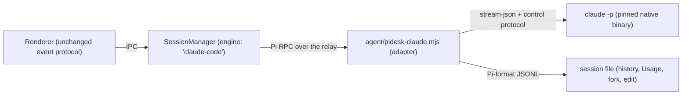

# Claude Code engine

A conversation can run on **Claude Code** instead of Pi. The desktop keeps everything it already does for Pi conversations: local and SSH machines, relays that survive disconnects, history pages, Git review, file preview, `@file`, Usage and Request TPS. Only the agent inside changes.

## How it works



- **The adapter** (`agent/pidesk-claude.mjs`) is started by the relay exactly like a Pi process and answers Pi's RPC commands (`prompt`, `abort`, `get_state`, `get_entries`, `get_session_stats`, `get_commands`, `compact`, `clone`, `fork`, `get_fork_messages`, `switch_session`, plus `claude_configure`). Inside it drives `claude -p --input-format stream-json --output-format stream-json --include-partial-messages --permission-prompt-tool stdio --replay-user-messages --forward-subagent-text`.
- **Events**: Claude Code's raw Anthropic stream becomes Pi's `message_start` / `message_update` / `message_end`; tool results become `tool_execution_start|update|end` and `toolResult` messages. Replies carry Pi `usage` (priced with the model's rates from the catalog) and `__timing` (`requestStart` comes from Claude Code's `status: requesting`), so Usage and Request TPS work as they do for Pi.
- **Tools**: Claude Code's core tools appear under Pi's names and argument shapes, so file links, diffs, folded rows and Git changes render as before: `Read→read`, `Write→write`, `Edit/MultiEdit→edit` (`{ path, edits: [{ oldText, newText }] }`), `Bash→bash`, `Grep→grep`, `Glob→find`, `LS→ls`. The original name and input stay on the block as `ccName` / `ccInput`. Every other tool keeps its Claude Code name (`Task`, `TodoWrite`, `WebFetch`, `WebSearch`, `Skill`, `NotebookEdit`, `Workflow`, `mcp__…`).
- **History**: the adapter writes a Pi-format session file (`<agentDir>/sessions/--cwd--/<ts>_<uuid>.jsonl`, header `engine: "claude-code"`); entries carry `cc: { sessionId, uuid }`, which is where `--resume`, `--fork-session` and `--resume-session-at` continue. Claude Code keeps its own transcript in its private config directory.
- **Approvals**: Pi Desktop runs tools without prompts, so `can_use_tool` is answered automatically, except `AskUserQuestion` (a `select`/`input` question card) and `ExitPlanMode` (a `confirm` card).

## Installation (requirements 1 and 6)

`app/main/claude-code.mjs` pins one release (`CLAUDE_CODE_VERSION`) and the SHA-512 of every platform package.

| Where | Binary | Config (`CLAUDE_CONFIG_DIR`) |
| --- | --- | --- |
| This Mac | `<userData>/claude-code/<version>/claude` | `<userData>/claude-code/config` |
| SSH host | `<install root>/claude-code/<version>/claude` (the root Pi uses, e.g. `~/.pidesk`) | `<install root>/claude-code/config` |

- A `claude` on PATH is never used, and `~/.claude` is never read: the private config directory means a Claude subscription signed in on the machine is ignored. Credentials come only from Settings → Models (`ANTHROPIC_API_KEY`, `ANTHROPIC_BASE_URL`, `ANTHROPIC_CUSTOM_HEADERS`). The adapter refuses to continue if Claude Code reports any other credential source.
- **SSH hosts**: the host downloads its own build (glibc/musl and x64/arm64 detected) from the npm registry, then `registry.npmmirror.com`, and checks the pinned checksum. If it has no internet (or no curl), this Mac downloads the build once (cached in `<userData>/downloads`, verified) and **uploads it over SSH** with progress. `PIDESK_FORCE_CLAUDE_UPLOAD=1` forces the upload path; `PIDESK_CLAUDE_REGISTRY` adds a registry.
- Installation happens on first use, or ahead of it via `prewarm({ engine: 'claude-code' })` / `prepareClaudeCode(environmentId)`. Progress: the `claude-code` IPC channel (`{ id: environmentId, status: 'preparing' | 'ready' | 'error', message, version }`) and the session's `status` events (`phase: 'preparing'`, `message: 'Downloading Claude Code… 35%'`).

## Models (requirements 2 and 3)

Only models whose `api` is `anthropic-messages` run Claude Code: built-in Anthropic and any built-in or custom provider that speaks the Anthropic Messages API. The catalog now includes `api`, `cost` and `engines` (`['pi', 'claude-code']` or `['pi']`) for every model. `create`, `setModel` and every start reject other models with *“Claude Code works only with Anthropic Messages models.”*

On a custom endpoint the conversation's model also becomes Claude Code's background and agent model (`ANTHROPIC_DEFAULT_{HAIKU,SONNET,OPUS}_MODEL`, `CLAUDE_CODE_SUBAGENT_MODEL`), because such endpoints serve only the models they list. A custom base URL saved with `/v1` is stripped (the Anthropic SDK appends `/v1/messages`).

## Claude Code features (requirement 4)

| Feature | Backend |
| --- | --- |
| Effort (`low` `medium` `high` `xhigh` `max`) | `setEffort(id, level)`; `setThinking` maps Pi levels to the nearest one. Applied live (`apply_flag_settings`). |
| Ultracode | `setUltracode(id, on)` → `{ ultracode }`. If the model/endpoint does not offer it, it is turned off, the record is updated and a warning `notice` explains why. The `ultracode` keyword in a prompt also works. |
| Fast mode | `setSpeed(id, 'fast')` → Claude Code's `fastMode` where the model offers it. |
| Slash commands, skills, custom commands | `commands(id)` returns Claude Code's own list (`source: 'claude-code'`, optional `argumentHint`), including its `/goal`, `/review`, `/context`, `/compact`. Local command output (e.g. `/context`) arrives as an assistant message with `__localCommand: true`. |
| CLAUDE.md, project `.claude/` settings, `.mcp.json` | Loaded by Claude Code from the conversation folder as usual. |
| Agents (`Task`) | The call's live result is a `tool_execution_update` with `details: { kind: 'claude-code-agent', steps: [...] }`; the final `toolResult` has the steps and `details.agentRuns` (usage, counted once in Usage). |
| Compaction | `compact(id)` sends `/compact`; history gets a `compactionSummary` with Claude Code's summary. |
| Other Claude Code state | Forwarded as `{ type: 'claude_event', subtype, data }` events (background tasks, hooks…), ignored by the current UI. |

## Pi-only features (requirement 5)

Ultra, Pi Desktop's Subagents setting, `/goal` continuation and the background-jobs card belong to Pi. For Claude Code conversations `setUltra(id, true)` and `create({ ultra: true, engine: 'claude-code' })` are refused; `ultra(id)`, `agents(id)` and `jobs(id)` stay empty; spares (pre-warmed Pi processes) are never adopted.

## Compatibility (requirement 8)

- **Usage** (Settings → Usage): replies and agent runs are recorded from `message_end`, and local session files are scanned as before.
- **Request TPS / turn footer**: `usage.output` from `message_delta`, `__timing.requestStart` from `status: requesting`.
- **Context ring**: `stats(id)` uses Claude Code's `get_context_usage` when it is idle (`{ contextUsage: { tokens, contextWindow, percent } }`).
- **Stop / interrupt-and-send**: `abort` sends Claude Code's `interrupt`; the partial reply ends with `stopReason: 'aborted'`, never a red error.
- **Fork / edit message**: `clone` copies the branch and continues with `--resume <id> --fork-session`; editing an earlier message also passes `--resume-session-at <uuid of the message before it>`.
- **Title**: the first line of the first message (Claude Code's own `session_title_changed`, when sent, renames it).

## Frontend contract (for the UI work)

New session:

```js
api('createSession', { environmentId, cwd, model: { provider, id }, engine: 'claude-code', effort /* optional */, ultracode /* optional */, prompt })
api('prewarm', { environmentId, cwd, model, engine: 'claude-code' }) // installs the binary early
```

Session view: `session.engine === 'claude-code'`, plus `session.effort`, `session.ultracode`. API: `setEffort(id, level)`, `setUltracode(id, on)`, `setModel` (Anthropic Messages models only), `setSpeed`, `commands(id)`, `claudeCodeInfo()` → `{ version, efforts }`, `prepareClaudeCode(environmentId)` → `{ ok, version } | { ok: false, error }`. Events: the `claude-code` channel above; `status` with `phase: 'preparing'` and `statusMessage` during installation.

UI work left to do:

1. An engine choice for new conversations (Pi / Claude Code) and a Claude Code badge on its conversations.
2. Model menus filtered by `model.engines.includes('claude-code')` for Claude Code conversations.
3. A Claude Code composer: effort (5 levels) and an Ultracode switch instead of Pi's thinking levels, Ultra and Subagents; Claude Code's slash commands with their `argumentHint`.
4. Cards for Claude Code's own tools (`Task` steps, `TodoWrite`, `WebFetch`/`WebSearch`, `Skill`, `Workflow`, `mcp__*`), and installation progress (“Downloading Claude Code… 35%”, “Uploading Claude Code from this Mac… 60%”) instead of “Preparing remote environment…”.
5. Remove Settings → Agents (the Subagents mode stays at its saved value).

## Tests

`test/claude-code.test.mjs` (part of `npm run test:backend`) uses `test/fixtures/fake-claude.mjs`, which follows the records of Claude Code 2.1.x, and `test/mock-anthropic.mjs`, a local Anthropic Messages endpoint. `PIDESK_REAL_CLAUDE=/path/to/claude node --test test/claude-code.test.mjs` also runs the real binary end to end against the mock.
